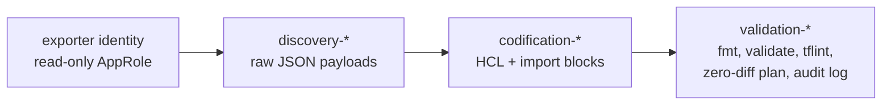

# terraform-vault-vault-codifier

Agent skills that survey a live HashiCorp Vault Enterprise cluster **read-only** and generate Terraform HCL for the `hashicorp/vault` provider (4.8.0), with `import {}` blocks, so that `terraform plan` reports no changes against the cluster.

It never writes to the cluster it surveys, and generated files never contain secrets.

## How it works



1. **Discovery** reads namespaces, mounts, policies, identity and system settings with `vault`, `curl` and `jq`, as the `exporter` identity.
2. **Codification** turns the payloads into Terraform in three state layers (`admin/`, `namespaces/`, `seed/`). Each Vault object has one owning capability, one file and one import block.
3. **Validation** proves the output: valid HCL, zero-diff plan after import, idempotent re-runs, read-only audit log, no secrets.

| Capability | Covers | Skills |
|---|---|---|
| `namespaces` | `vault_namespace` hierarchy | `discovery-namespaces`, `codification-namespaces` |
| `root-config` | audit devices, quotas, a "not managed by Terraform" table | `discovery-root-config`, `codification-root-config` |
| `policies` | ACL, EGP and RGP policies, correlation matrix | `discovery-policies`, `codification-policies` |
| `auth-mounts` | auth methods, roles and config | `discovery-auth-mounts`, `codification-auth-mounts` |
| `secrets-engines` | mounts and engine config; secret data is never read | `discovery-secrets-engines`, `codification-secrets-engines` |
| `teams` | identity groups, entities, aliases | `discovery-identity-teams`, `codification-teams` |
| `admin-config` | the `admin` namespace composition, human auth | `discovery-admin-config`, `codification-admin-config` |

Supporting skills: `vault-codifier-conventions` (read first), `vault-exporter-setup`, `discovery-orchestrator`, `codification-layer-assembly`, and five `validation-*` skills. There are 23 in [`skills/`](skills/), loadable by any agent that reads the `SKILL.md` format.

## Quick start (harness)

You need Docker with Compose, `terraform` 1.9 or later, `vault` 1.17 or later, `jq`, `make`, and a Vault Enterprise licence at `tmp/vault.hclic` (never committed; see [`test/PREREQUISITES.md`](test/PREREQUISITES.md)).

```bash
export PATH=$PATH:$HOME/.local/bin:/opt/homebrew/bin:$HOME/.rd/bin
export VAULT_CONFIG_PATH=/dev/null VAULT_ADDR=http://127.0.0.1:8200
export VAULT_TOKEN=root          # harness only

make -C test all                 # Vault Enterprise 2.2.2+ent in dev mode, seeded with synthetic data
make codify-test                 # discover, codify twice, validate, about 90 seconds
```

`make codify-test` ends with a verdict for each of the seven cross-cutting acceptance criteria (CAC1 to CAC7). The reports are in `discovered_terraform/validation/`.

For the step-by-step flow, from the exporter token to a zero-diff plan and applying the imports to a real cluster, see the [usage guide](docs/usage-guide.md).

## Make targets

Run `make help` for the list. The main ones: `assemble`, `ownership`, `static-gate`, `zero-diff`, `verify`, `verify-selftest`, `variants` and `codify-test`. The validation targets run against `127.0.0.1` only.

## Layout

| Path | Contents |
|---|---|
| [`skills/`](skills/) | The deliverable: skills with `SKILL.md`, `scripts/` and `references/` |
| [`test/`](test/) | Synthetic brownfield harness: docker compose and three Terraform layers |
| [`discovered_terraform/`](discovered_terraform/) | `raw/` (git-ignored), `terraform/` (generated), `validation/` (reports) |
| [`docs/`](docs/) | [Usage guide](docs/usage-guide.md), [waza review](docs/waza-review.md) |
| [`openspec/changes/vault-brownfield-research/`](openspec/changes/vault-brownfield-research/) | Specs, design, tasks |
| [`tmp/`](tmp/) | Research notes: domain model, resource map, discovery guide, HVD matrix |

## Security

- **Read-only.** Discovery uses the `exporter` identity, which has no write capability and is denied KV data and AppRole credentials. The orchestrator refuses a root token and refuses to run without an audit device. `make verify` checks the audit log for anything but `read` and `list`.
- **No secrets.** Sensitive arguments become `sensitive` variables with no default. Generators stop when a payload holds a credential field. `discovered_terraform/raw/` is git-ignored.
- **Harness only.** The root token `root`, `127.0.0.1:8200` and TLS-off settings exist for local testing. Do not reuse them.
- **Licence.** Never commit a Vault licence file.

## Limits

- Auth methods other than AppRole and engines other than KV v2 are emitted as mounts and listed in a coverage report for manual review.
- EGP, RGP and MFA are not exercised against a live cluster.
- Enterprise settings with no provider resource (seal, licence, replication) are reported, not codified.

See [`STATUS_REPORT.md`](STATUS_REPORT.md) for evidence and open risks, and [`AGENTS.md`](AGENTS.md) before contributing.

## Licence

No licence has been chosen yet. It is recorded as an open decision in TASK-032.
