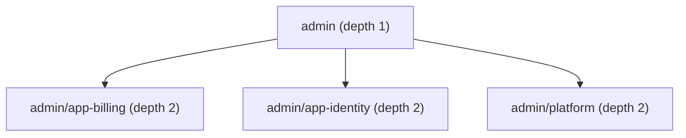

# Namespace hierarchy

| Full path | Parent | Id | custom_metadata | Depth |
|---|---|---|---|---|
| `admin` | root | `qOOjV` | none | 1 |
| `admin/app-billing` | `admin` | `FJ3lt` | description = Billing application team namespace | 2 |
| `admin/app-identity` | `admin` | `x7ROq` | description = Identity service team namespace | 2 |
| `admin/platform` | `admin` | `CaNRp` | description = Platform engineering team namespace | 2 |
