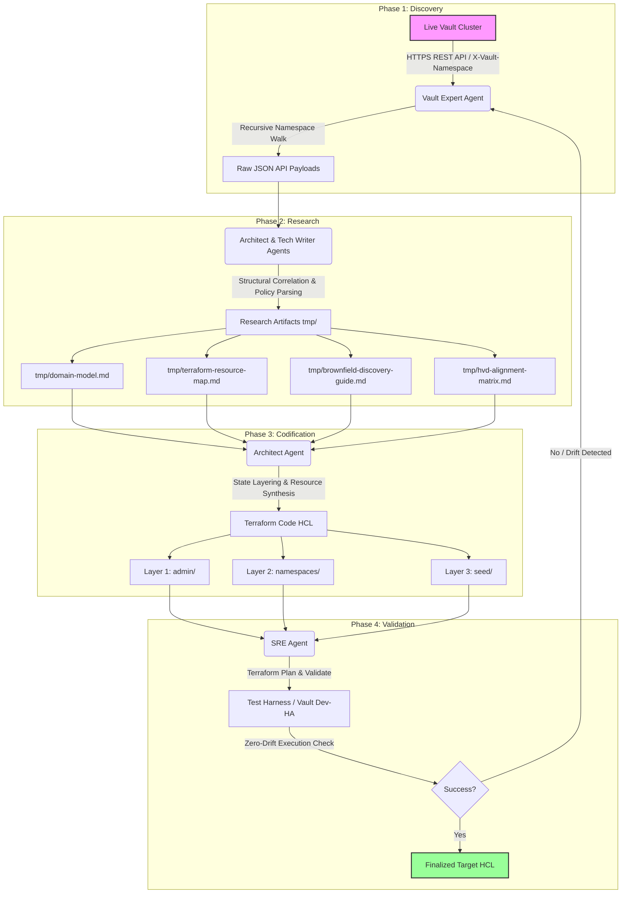

# Introduction

This document presents the technical design for the automated, agentic workflow that interrogates a live, brownfield HashiCorp Vault Enterprise cluster and codifies its configuration into idiomatic Terraform HCL. The target output aligns with HashiCorp Validated Design (HVD) guidelines and mirrors the local test harness environment.

## 1. Purpose & Scope

### 1.1 Goal
To design a spec-driven, multi-agent pipeline that automates the transition of an unmanaged, live Vault Enterprise cluster to structured, version-controlled Infrastructure-as-Code (IaC) using the `hashicorp/vault` provider (pinned at `~> 4`).

### 1.2 Target Test Harness
- **Platform**: Vault Enterprise 2.2.2+ent running in `dev-ha` mode.
- **Root Namespace**: Root operator policies, global quotas, file audit device, and initial `admin` namespace.
- **Tenant Namespaces**: `admin/platform`, `admin/app-billing`, `admin/app-identity` (nested under the `admin` organizational boundary).
- **Auth Backends**: AppRole authenticated access within each tenant namespace.
- **Secrets Engines**: Version 2 Key-Value (KV v2) mounts under `secret/` inside each tenant namespace.
- **Identity Store**: Synthetic users, internal identity groups, and group policy associations.

---

## 2. Architecture Overview (The Pipeline)

The codification workflow runs as an iterative pipeline divided into four distinct, sequential phases. Each phase translates unstructured cluster data into higher-level logical abstractions, culminating in validated HCL code.



### 2.1 Phase 1: Discovery
The **Vault Expert** uses Vault's REST API and CLI to recursively scan the cluster. Authenticated via a high-privilege token (e.g., `root`), it traverses the namespace tree, querying system backends, mount configurations, identity stores, and policies. Output is a directory of structured raw JSON files representing the raw state.

### 2.2 Phase 2: Research
The **Architect** and **Technical Writer** ingest the raw JSON payloads and correlate isolated resources. They build logical maps (e.g., linking an AppRole in a sub-namespace to its policy document and identity entities). They write human-and-agent-readable files in the `tmp/` directory summarizing the findings.

### 2.3 Phase 3: Codification
The **Architect** parses the research artifacts and synthesizes the corresponding Terraform code. Rather than dumping all resources into a single file, the Architect partitions the resources into three state layers (`admin/`, `namespaces/`, `seed/`) matching the lifecycle boundary of the resources.

### 2.4 Phase 4: Validation
The **SRE** takes the generated Terraform code, configures backend providers with target connection parameters, and runs a series of dry-run deployments against the live test harness. The SRE verifies that running `terraform plan` produces an empty change block (zero-drift) or lists only approved delta modifications (such as synthetic secret payload masking).

---

## 3. Agent Roles & Responsibilities

The orchestrator coordinates four distinct sub-agents, each focused on a specific domain:

| Role | Primary Responsibilities | Deliverables |
|:---|:---|:---|
| **Vault Expert** | Interrogating Vault endpoints, walking namespace trees, extracting raw JSON payloads, identifying active mounts, policies, and identities. | Raw API payloads, API-to-CLI invocation mappings. |
| **Solution Architect** | Defining the target code hierarchy, mapping Vault API concepts to Terraform resources, planning state boundaries, structuring parameters, and managing state relationships. | `terraform-resource-map.md`, modular Terraform structure (`admin/`, `namespaces/`, `seed/`). |
| **SRE** | Deploying verification harnesses, executing local test suites, performing linting, running plan and validate commands, and unsealing and testing token lifecycles. | `terraform plan` execution logs, linting reports, zero-drift verification checklist. |
| **Technical Writer** | Documenting findings, mapping structural models to business owners, authoring the brownfield discovery guide, and analyzing security postures against HVD guidelines. | `domain-model.md`, `brownfield-discovery-guide.md`, `hvd-alignment-matrix.md`. |

---

## 4. Discovery Protocol

To discover Vault's configuration without causing performance overhead, the **Vault Expert** queries endpoints in a structured, sequential order. All commands use the active namespace context by passing the `X-Vault-Namespace` header.

### 4.1 Capability Sequence & Endpoints

#### Phase 4.1.1: `root-config` (Root Namespace Discovery)
- **File Audit Device**:
  - *API Endpoint*: `GET /v1/sys/audit`
  - *CLI Equivalent*: `vault audit list`
- **Global Rate-Limit Quotas**:
  - *API Endpoint*: `GET /v1/sys/quotas/rate-limit`
  - *CLI Equivalent*: `vault read sys/quotas/rate-limit`
- **Seal Configuration**:
  - *API Endpoint*: `GET /v1/sys/seal-status`
  - *CLI Equivalent*: `vault status`
- **Enterprise License**:
  - *API Endpoint*: `GET /v1/sys/license`
  - *CLI Equivalent*: `vault read sys/license`
- **System Replication**:
  - *API Endpoint*: `GET /v1/sys/replication/performance/status` and `GET /v1/sys/replication/dr/status`
  - *CLI Equivalent*: `vault read sys/replication/performance/status`

#### Phase 4.1.2: `namespaces` (Hierarchy Walk)
- **Sub-namespace Enumeration**:
  - *API Endpoint*: `LIST /v1/sys/namespaces` (using HTTP method `LIST` or `GET` with query param `list=true`)
  - *CLI Equivalent*: `vault namespace list`

#### Phase 4.1.3: `admin-config` (Organizational Admin Namespace Discovery)
Executed inside the `admin` namespace boundary:
- **Operator Policies**:
  - *API Endpoint*: `GET /v1/sys/policies/acl` (to list), and `GET /v1/sys/policies/acl/<name>` (to read)
  - *CLI Equivalent*: `vault policy list` and `vault policy read <name>`
- **Human OIDC/LDAP Auth Backend**:
  - *API Endpoint*: `GET /v1/sys/auth`
  - *CLI Equivalent*: `vault auth list`

#### Phase 4.1.4: `auth-mounts` (Auth Method Enumeration)
Executed recursively inside every discovered namespace:
- **Auth Methods**:
  - *API Endpoint*: `GET /v1/sys/auth`
  - *CLI Equivalent*: `vault auth list`
- **AppRole Role Configurations**:
  - *API Endpoint*: `LIST /v1/auth/<path>/role` and `GET /v1/auth/<path>/role/<role_name>`
  - *CLI Equivalent*: `vault write -method=LIST auth/<path>/role` and `vault read auth/<path>/role/<role_name>`

#### Phase 4.1.5: `secrets-engines` (Engine Enumeration)
Executed recursively inside every discovered namespace:
- **Secrets Engines**:
  - *API Endpoint*: `GET /v1/sys/mounts`
  - *CLI Equivalent*: `vault secrets list`
- **Mount Tuning Parameters**:
  - *API Endpoint*: `GET /v1/sys/mounts/<path>/tune`
  - *CLI Equivalent*: `vault read sys/mounts/<path>/tune`

#### Phase 4.1.6: `policies` (ACL Policy Discovery)
Executed recursively inside every discovered namespace:
- **ACL Policies**:
  - *API Endpoint*: `LIST /v1/sys/policies/acl` and `GET /v1/sys/policies/acl/<policy_name>`
  - *CLI Equivalent*: `vault policy list` and `vault policy read <policy_name>`

#### Phase 4.1.7: `teams` (Identity Store Discovery)
Executed primarily inside the `admin` organizational namespace:
- **Identity Entities**:
  - *API Endpoint*: `LIST /v1/identity/entity/id` and `GET /v1/identity/entity/id/<id>`
  - *CLI Equivalent*: `vault list identity/entity/id` and `vault read identity/entity/id/<id>`
- **Identity Groups**:
  - *API Endpoint*: `LIST /v1/identity/group/id` and `GET /v1/identity/group/id/<id>`
  - *CLI Equivalent*: `vault list identity/group/id` and `vault read identity/group/id/<id>`
- **Identity Group Aliases**:
  - *API Endpoint*: `LIST /v1/identity/group-alias/id` and `GET /v1/identity/group-alias/id/<id>`
  - *CLI Equivalent*: `vault list identity/group-alias/id` and `vault read identity/group-alias/id/<id>`

---

## 5. Terraform Resource Mapping

The following mapping matrix drives the conversion engine from raw Vault API responses to `hashicorp/vault` Terraform provider resources.

| Vault Object / API Endpoint | Target Terraform Resource | Key Attributes Captured & Mapped |
|:---|:---|:---|
| `/sys/audit` | `vault_audit` | `type`, `options` (e.g., `file_path`), `description` |
| `/sys/namespaces` | `vault_namespace` | `path`, `custom_metadata` (e.g., description, billing owner) |
| `/sys/policies/acl/<name>` | `vault_policy` | `name`, `policy` (HCL document parsed into inline or heredoc string) |
| `/sys/auth` | `vault_auth_backend` | `type`, `path`, `description`, `tune` config (max/default TTL) |
| `/sys/mounts` | `vault_mount` | `type`, `path`, `options` (e.g., `version = "2"`), `description` |
| `/auth/approle/role/<name>` | `vault_approle_auth_backend_role` | `role_name`, `backend` path, `token_policies`, `token_ttl`, `token_max_ttl`, `secret_id_num_uses`, `secret_id_ttl` |
| `/sys/quotas/rate-limit` | `vault_quota_rate_limit` | `name`, `path`, `rate`, `interval`, `block_interval` |
| `/identity/entity` | `vault_identity_entity` | `name`, `metadata`, `disabled` |
| `/identity/group` | `vault_identity_group` | `name`, `type` (internal/external), `policies`, `member_entity_ids`, `metadata` |
| `/identity/group-alias` | `vault_identity_group_alias` | `name`, `mount_accessor`, `canonical_id` |
| `/secret/data/<path>` (KV v2) | `vault_kv_secret_v2` | `mount`, `name`, `data_json` (masked with synthetic placeholders) |

---

## 6. Namespace Traversal Strategy

To handle nested business units in Vault Enterprise (such as `admin/platform`), the discovery engine implements a recursive depth-first traversal of the namespace tree.

### 6.1 Logical Traversal Algorithm

```
Algorithm TraverseNamespace(current_path, logical_header_path)
    1. Authenticate client with Vault API using X-Vault-Namespace = logical_header_path
    2. Extract local resources at current_path:
        a. Query auth methods (sys/auth)
        b. Query secrets engines (sys/mounts)
        c. Query local policies (sys/policies/acl)
        d. Query AppRoles and local parameters
    3. Query LIST /v1/sys/namespaces to get nested namespaces under logical_header_path
    4. If response is empty or 404/403, return (leaf node reached)
    5. For each child namespace found:
        a. Calculate child_header_path = logical_header_path + "/" + child.name
        b. TraverseNamespace(child.name, child_header_path)
```

### 6.2 Pseudocode Implementation for discovery agent

```python
def discover_namespace_recursive(client, current_ns_path=""):
    """
    Recursively scans Vault namespaces starting from the root or authenticated anchor.
    """
    print(f"Interrogating Namespace: {current_ns_path or 'root'}")
    
    # 1. Capture resources local to this namespace
    ns_metadata = {
        "path": current_ns_path,
        "auth_methods": client.sys.list_auth_methods(namespace=current_ns_path),
        "secrets_engines": client.sys.list_mounted_secrets_engines(namespace=current_ns_path),
        "policies": client.sys.list_policies(namespace=current_ns_path),
    }
    
    save_raw_payload(current_ns_path, "meta.json", ns_metadata)
    
    # 2. Query child namespaces
    try:
        children_payload = client.sys.list_namespaces(namespace=current_ns_path)
        children = children_payload.get("data", {}).get("keys", [])
    except Exception as e:
        # Handles instances where namespace API access is forbidden or unavailable (leaf nodes)
        children = []

    for child in children:
        child_clean = child.strip("/")
        # FQNamespace: admin -> admin/platform -> admin/platform/nested
        child_fq_path = f"{current_ns_path}/{child_clean}" if current_ns_path else child_clean
        
        # Recurse
        discover_namespace_recursive(client, child_fq_path)
```

---

## 7. State Layering

To prevent tight coupling of global configurations with application-level credentials, the produced Terraform HCL is partitioned into three decoupled folders. This matches the state boundaries configured in `test/terraform/`.

```
discovered_terraform/
├── admin/                     # Layer 1: Global / Root configuration
│   ├── providers.tf           # Connects to root namespace (token-authenticated)
│   ├── variables.tf
│   ├── main.tf                # File audit devices, global rate limits, admin namespace
│   ├── outputs.tf             # Outputs the admin namespace path
│   └── policies/
│       └── operator.hcl
│
├── namespaces/                # Layer 2: Organizational Administration
│   ├── providers.tf           # Connects to admin namespace
│   ├── variables.tf
│   ├── main.tf                # Provisions platform/app-* tenant namespaces, admin identities
│   ├── outputs.tf             # Outputs tenant namespace paths and group IDs
│   └── policies/
│       ├── admin.hcl
│       └── namespace_admin.hcl
│
└── seed/                      # Layer 3: Tenant Application Resources
    ├── providers.tf           # Connects directly to tenant namespaces via individual aliases
    ├── variables.tf
    ├── main.tf                # Local KV engines, local policies, AppRoles, and KV v2 seeds
    └── outputs.tf
```

### 7.1 Layer 1: Global Operator (`admin/`)
- **Focus**: Physical cluster maintenance, system auditing, and bootstrapping the first logical namespace boundary.
- **Provider Context**: Authenticates against the absolute root `/` namespace.
- **Synthesized Resources**:
  - `vault_audit` (e.g., `/vault/logs/audit.log`)
  - `vault_quota_rate_limit` (e.g., global-rate-limit)
  - `vault_namespace` (`admin`)
  - `vault_auth_backend` (`approle_root`)
  - `vault_approle_auth_backend_role` (`terraform-admin`)

### 7.2 Layer 2: Organization Boundary (`namespaces/`)
- **Focus**: Organizational administration, user federation, group policy assignment, and workspace/tenant vending.
- **Provider Context**: Authenticates inside the `admin` namespace using the provisioner AppRole generated in Layer 1.
- **Synthesized Resources**:
  - `vault_namespace` (`platform`, `app-billing`, `app-identity`)
  - `vault_policy` (`admin`, `namespace-admin`)
  - `vault_auth_backend` (`approle_admin`)
  - `vault_approle_auth_backend_role` (`namespace-provisioner`)
  - `vault_identity_group` (`tenant_admin` and team groups)
  - `vault_identity_entity` (synthetic user definitions)

### 7.3 Layer 3: Tenant Domain (`seed/`)
- **Focus**: Application-level secrets engines, service-to-service authentication backends, application policies, and secret payload storage.
- **Provider Context**: Uses multiple Terraform Vault provider aliases, each targeted specifically to a child namespace (`admin/platform`, `admin/app-billing`, `admin/app-identity`) using AppRoles limited to those boundaries.
- **Synthesized Resources**:
  - `vault_mount` (KV v2 mounts under `secret/` inside tenant namespaces)
  - `vault_policy` (SRE-read, Dev-write policies)
  - `vault_auth_backend` (`approle` per tenant namespace)
  - `vault_approle_auth_backend_role` (`platform-ci`, `billing-service`, `identity-service`)
  - `vault_kv_secret_v2` (individual application configuration parameters)

---

## 8. Research Artifact Schema

The **Technical Writer** produces four Markdown files under `tmp/` summarizing the cluster's brownfield configuration before generating Terraform HCL.

### 8.1 `tmp/domain-model.md`
- **Schema**:
  - **Organization Boundary**: Logical tenant hierarchy (namespaces and parent-child relationships).
  - **Actors**: Human identities, groups, and automated system service accounts.
  - **Authorization**: Active policy matrix detailing roles and allowed API pathways.
  - **Secrets Inventory**: Active secrets engines, types, and mount points.

### 8.2 `tmp/terraform-resource-map.md`
- **Schema**:
  - A comprehensive inventory table detailing the translation of live objects to code assets:
    `Vault Namespace` | `Vault API Path` | `Object Type` | `Target Terraform Resource Name` | `State Layer`

### 8.3 `tmp/brownfield-discovery-guide.md`
- **Schema**:
  - **Prerequisites**: Permissions required (token capabilities) to scan the cluster.
  - **Walkthrough**: Manual API commands (`curl` syntax and payload samples) to verify automated outputs.
  - **Troubleshooting**: Handling access denied errors (403), leaf namespace detection, and token expiration during scans.

### 8.4 `tmp/hvd-alignment-matrix.md`
- **Schema**:
  - **Policy Analysis**: Scoring of current ACL policy files against least-privilege principles (identifying wildcards like `secret/*`).
  - **Namespace Separation Checklist**: Verification that tenants are isolated and lack cross-namespace visibility.
  - **Identity Group Verification**: Evaluation of whether policies are bound to Vault Identity Groups rather than tied directly to transient AppRole tokens.

---

## 9. HashiCorp Validated Design (HVD) Alignment

The codifier enforces structural standards that align with official HashiCorp Validated Design (HVD) guidelines.

### 9.1 Principle of Least Privilege (ACL Policies)
- The codifier audits and parses raw policy documents. If it detects broad permissions (e.g., root or `sys/*` capabilities in tenant spaces), it generates an alert and structures tenant policies to limit path boundaries strictly to team-owned secrets paths (e.g., `secret/data/platform/sre/*` for SRE engines).

### 9.2 Namespace Isolation
- Standardizes on the admin-tenant-application structure. Shared secrets engines across tenant boundaries are treated as non-compliant. The codifier maps each tenant to its own namespace, with local secrets engines mounted on individual paths.

### 9.3 Localized Auth Methods
- Instead of using a centralized authentication backend at the root namespace, auth methods (such as AppRole) are provisioned locally within the specific namespace of the tenant owning the application (e.g., `/admin/app-billing/approle`). This prevents cross-tenant credential exposure if a backend is compromised.

### 9.4 Identity-Centric Access Control
- Integrates auth backends with the Vault Identity Store. Policy mappings are assigned to `vault_identity_group` resources. Authentication mechanisms (AppRole, OIDC) map to group memberships, enabling centralized, dynamic permission management instead of manual token policy associations.

---

## 10. Constraints & Architectural Decisions (ADRs)

### 10.1 ADR-001: Local Dev-HA Mode Target
- **Context**: Real enterprise environments run Multi-Region Performance Replication clusters.
- **Decision**: The test harness and discovery validation target a local single-node cluster simulated in `dev-ha` mode using Raft storage. This provides high availability features (such as transit sealing and namespace capabilities) without the overhead of physical multi-cluster routing.

### 10.2 ADR-002: Version Pin and Provider Setting
- **Context**: Upgrades to major versions of the `hashicorp/vault` provider can introduce breaking resource parameter changes.
- **Decision**: The generated HCL files are pinned strictly to provider version `~> 4` (targeting installed 4.8.0). Furthermore, the provider blocks in Layer 1 and 2 explicitly define `skip_child_token = true`. This prevents Vault from generating temporary child tokens for every API invocation, which is necessary when deploying using high-privilege automation pipelines.

### 10.3 ADR-003: Synthetic Data Payload Masking
- **Context**: Exporting production KV secrets to git repositories violates standard security practices.
- **Decision**: The codification engine discovers the metadata of all secrets, but **never** writes real secret payloads to HCL files. Instead, it queries the key structure and inserts synthetic values formatted with the prefix `SYNTHETIC-*-REPLACE-IN-PRODUCTION`. This allows administrators to safely commit the generated infrastructure definitions to source control and replace the values during deployment using secure variable injectors (such as Vault Agent or environment variables).

---

## 11. Test Automation & Validation Strategy

The **SRE** validates the generated Terraform HCL code using a local validation suite.

- **Phase 1: Format & Lint**:
  Run `terraform fmt -check` and `tflint` to verify that the generated HCL code conforms to standard syntax and spacing specifications.
- **Phase 2: Schema Validation**:
  Run `terraform validate` inside each directory (`admin/`, `namespaces/`, `seed/`) to ensure references, providers, and resource variables are structurally correct.
- **Phase 3: Plan Verification**:
  Initialize backend configurations against the live Docker-compose Vault instance and execute `terraform plan`. The output plan must verify that the codified resources are synchronized with the active cluster state, returning a `No changes. Infrastructure is up-to-date` status (or showing only expected masked changes).

---

## 12. Related Specifications

- [`test/PREREQUISITES.md`](../../test/PREREQUISITES.md) - Local test environment configuration.
- [`openspec/changes/vault-brownfield-research/proposal.md`](proposal.md) - Initial project proposal.
- HashiCorp Validated Designs - [Vault Administration Guide](https://developer.hashicorp.com/vault/tutorials/validated-designs)
