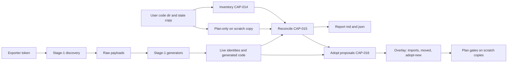

# Design: vault-codifier-existing-terraform

Decisions for CAP-014 to CAP-016. Stage-1 design and the skills under `skills/` remain authoritative for everything not named here. Vault documentation is cited as repository-relative paths in `git@github.com:hashicorp/web-unified-docs.git` (see `openspec/config.yaml`).

## 1. Problem shape

Stage 1 answers "what does the cluster hold, as Terraform?". This change answers a different question: "the cluster is partly managed already, so what is the difference between that management and the cluster, and what is the smallest safe change to close it?".

Three sources describe the same objects:

| Source | Holds | Read how |
|---|---|---|
| Code (C) | Which objects the team intends to manage, under which labels and provider aliases | Static extraction from `*.tf` |
| State (S) | Which objects Terraform believes it manages, with their ids | `terraform show -json` of a user-supplied local copy |
| Live (L) | What the cluster has | Stage-1 discovery with the exporter identity; identities taken from the stage-1 generated `import {}` blocks |

The terms C, S and L are used in the specs. The tool's job is to join them on an identity key and say what the join shows.

## 2. Data flow and roles



Data flow, in the order the project rules ask for: discovery (stage 1) → research artifact (inventory and report) → spec (classification model) → Terraform HCL (overlay).

| Role | Does | Deliverables |
|---|---|---|
| Vault Expert | Reads the user's code and state, derives identity keys per type, checks what the exporter can refresh | `discovery-existing-terraform` skill, `inventory.json`, the per-type identity table |
| Solution Architect | Defines the classification model, the overlay layout and the rule that the overlay is additive | `reconcile-existing-terraform`, `codification-adopt-proposals` skills, this design |
| SRE | Builds the fixture, runs the plan-only gates, checks the audit log, wires the `make` target | fixture generator, `validation-existing-terraform` skill, `existing-terraform` report |
| Technical Writer | Documents inputs, outputs, classes and the human decisions | `docs/existing-terraform.md`, traceability rows, `README.md` in the overlay |

## 3. Decisions

### ADR-1: Match on identity, not on address

The Terraform label is a team's choice. Two teams can name the same policy differently, and a team can rename a label at any time. If the join used the address, every rename would show as an orphan plus a gap, and the proposal would be a destroy and a create. The join uses the identity key `<type>|<namespace>|<import id>`, which is what the cluster knows. The address is a secondary signal used for `renamed`, `matched` and `state-only`.

The import ids come from the verified table in `task-006-decision.md` (for example `vault_auth_backend` uses the mount path without `auth/`, and `vault_namespace` uses the leaf name relative to its parent). The task-006 table is the single source of truth; this change adds no second one.

### ADR-2: State is primary for identity, code is secondary

A static parser for HCL in `bash` and `jq` cannot evaluate `for_each`, `count`, variables or modules. State can: `terraform show -json` lists every instance with its index key and module path. So identity comes from state wherever a state entry exists. Code adds only what state lacks: file names, provider alias or `namespace` argument, `ignore_changes`, existing `import {}` and `moved {}` blocks, and identities of never-applied resources whose identity arguments are string literals. Anything else is `unresolved` and is reported, not guessed. This follows the stage-1 style, which already uses `awk` to read the generated `resource` and `import` blocks.

### ADR-3: The overlay is additive and in its own directory

The user's repository has owners, reviews and a pipeline. A tool that edits it is a tool that cannot be trusted with it. The overlay therefore writes only under `discovered_terraform/brownfield/overlay/` and has three parts:

| Part | Content | Why separate |
|---|---|---|
| `adopt-existing/imports.tf` | `import {}` blocks for resources already written in code but not in state | The user copies one file into their layer. The addresses are the user's own. |
| `adopt-existing/moved.tf.proposed` | `moved {}` blocks for renames | The `.proposed` suffix means Terraform does not read it until the user renames it. A move changes state and deserves an explicit step. |
| `adopt-new/<layer>/` | Stage-1 generated blocks, filtered to unmanaged identities | It has its own providers and its own state, so it does not depend on the user's aliases, labels or module layout. The user decides later whether to merge it. |

The overlay never contains a remedy for `drifted`, `state-only`, `orphan`, `out-of-policy`, `unresolved` or `unverifiable`. Those are the owner's decisions. The report lists the options (CAP-015 AC8) and the overlay `README.md` repeats them. For `state-only` and `orphan` the options are to restore the block, or to add a `removed {}` block with `destroy = false` (Terraform 1.7 and later; this project requires 1.9). For `drifted` the options are to update the code or to let the next apply revert the cluster.

### ADR-4: Attribute drift comes from plan-only on a scratch copy

Comparing attributes by hand would mean re-implementing the provider's read logic for every resource type. A plan already does it. The run is:

1. Copy the code directory and the state copy to a `mktemp` directory. The state copy becomes the local `terraform.tfstate`.
2. `terraform init -backend=false -input=false`. A user backend block is ignored, so no remote system is contacted and no remote lock is taken.
3. Export the exporter token and `TERRAFORM_VAULT_SKIP_CHILD_TOKEN=true`. The provider's default is to create a child token, which is a write. The stage-1 provider template already sets `skip_child_token = true` for the layers it generates, but the user's provider block may not, and the environment variable overrides it. The documented variable name is in the provider's `index` page; TASK-E04 confirms it against 4.8.0.
4. `terraform plan -lock=false -input=false -out=<scratch>` then `terraform show -json <scratch>`. Nothing is applied, imported or moved.
5. A `jq` program reads `resource_changes[]` and, for each `update`, lists the attribute names where `before` and `after` differ. It never prints either value. A name whose value is marked sensitive in `before_sensitive` or `after_sensitive` is reported as the name plus the word `sensitive`.
6. The scratch directory is deleted on exit.

The plan also proposes creates (code never applied) and deletes (state without code). Those are not remedies to apply; they are evidence for `unimported` and `state-only`.

**Known limit.** The exporter policy denies the AppRole role-id and secret-id paths and the KV data paths. If the provider reads those during refresh, the plan fails for that resource. The design does not widen the exporter policy, because those denies are a stage-1 safety property. Instead the plan is re-run with `-target` for the readable set, and the unreadable resources are classed `unverifiable` with the status recorded (CAP-015 AC6). TASK-E04 measures which fixture types are unreadable and records the answer in the skill.

### ADR-5: Harness first, real clusters later

The `127.0.0.1` guard is unchanged. A real cluster adds a guarded remote mode, an owner's approval and a rule that nothing from the cluster is committed. That work is `vault-codifier-remote-review` (CAP-013). When it lands, a follow-up change can extend its remote mode to the scripts here. Until then every script refuses a non-local address with exit 2, and the report in `discovered_terraform/validation/` is a harness report that is safe to commit.

### ADR-6: Reuse stage 1 for the live side

The live identities and the code for unmanaged objects are the stage-1 outputs. The tool does not read the cluster a second time, and it does not carry a second set of generators or a second id table. If stage 1 changes how an object is identified or generated, this change follows. The cost is that the live side is only as complete as stage 1; objects stage 1 does not yet codify (the stage-2 list) are invisible to the reconcile step until stage 2 lands, and the report states which capabilities were in scope for the run.

## 4. Identity key per resource type

TASK-E02 fills and verifies this table against provider 4.8.0 on the fixture. The import-id column is the task-006 value. The "from state" column is the rule the inventory uses to rebuild that value from `terraform show -json`.

| Type | Import id (task-006) | Rebuilt from state |
|---|---|---|
| `vault_namespace` | leaf name under its parent's provider | `path` attribute, last segment; namespace is the parent |
| `vault_policy` | policy name | `name` |
| `vault_auth_backend` | mount path without `auth/` | `path` |
| `vault_approle_auth_backend_role` | `auth/<mount>/role/<name>` | `backend` and `role_name` |
| `vault_mount` | mount path | `path` |
| `vault_kv_secret_backend_v2` | `<mount>/config` | `mount` |
| `vault_identity_group` | group UUID | `id` |
| `vault_identity_entity` | entity UUID | `id` |
| `vault_audit` | audit device path | `path` |
| `vault_quota_rate_limit` | quota name | `name` |
| `vault_generic_endpoint` | not importable | `path` |

For UUID-keyed types the key is the UUID. A hand-written code resource for such a type has no identity until it is applied or imported, so it is `unresolved` in code and its identity comes from state or live (name lookup in the stage-1 payloads is a TASK-E02 decision, recorded there).

## 5. Fixture design

TASK-E01 builds the fixture from the harness layers. Procedure:

1. Start a throwaway dev container on `127.0.0.1:18202`, removed on exit and on failure, like `validation-variants`. A digest of the real harness (namespaces, policies, mounts, entity names) is taken before and after, and the run fails if it differs.
2. Copy `test/terraform/{admin,namespaces,seed}` to a scratch directory as "the existing code" and apply them. Write `terraform show -json` of each layer's state to the fixture directory.
3. Apply the divergences F2 to F10 in the specs: edit the cluster out of band for F2 and F7, remove blocks and state entries for F3 and F6, remove a state entry for F4, rename a label for F5, add the forbidden type for F8, add a `for_each` with a non-literal key for F9, and confirm or create F10.
4. Write `expected.json`, the class per identity key. It is the oracle for CAP-014 AC10, CAP-015 AC3 and CAP-016 AC10.
5. Inject a marker value into one state attribute and one cluster attribute for the CAC13 scan.

The fixture is generated at run time from the committed harness layers, so the repository does not carry a second copy of the code. Only the generator, the divergence scripts and `expected.json` are committed.

## 6. Output layout

```
discovered_terraform/
├── brownfield/                  git-ignored run state
│   ├── inventory.json           CAP-014
│   ├── inventory.md
│   └── overlay/                 CAP-016
│       ├── adopt-existing/imports.tf
│       ├── adopt-existing/moved.tf.proposed
│       ├── adopt-new/<layer>/
│       └── README.md
└── validation/
    └── existing-terraform.{json,md}   CAP-015 report; harness runs only
```

`discovered_terraform/.gitignore` gains `brownfield/`. The report is committed only for harness runs, because it holds synthetic names.

## 7. Skills and ownership

| Skill | Role | Capability |
|---|---|---|
| `discovery-existing-terraform` | Vault Expert | CAP-014 |
| `reconcile-existing-terraform` | Solution Architect | CAP-015 |
| `codification-adopt-proposals` | Solution Architect | CAP-016 |
| `validation-existing-terraform` | SRE | CAP-014 to CAP-016 gates |

None owns a Vault resource type. `vault_*` types stay with their stage-1 owners in `vault-codifier-conventions`, and the overlay is built from those owners' generator output. Each `SKILL.md` stays within the 1,500-token limit in `.waza.yaml`; examples and schemas go in `references/`. Scripts run on bash 3.2 and `jq`, with no Python, and are idempotent, as in `AGENTS.md`.

## 8. Risks

| Risk | Mitigation |
|---|---|
| State secrets leak into a report or log | State is read from a copy; the `jq` programs select named fields only; out-of-policy instances are never read beyond type and address; CAC13 injects a marker and scans the whole output tree |
| The plan-only run writes to Vault | `TERRAFORM_VAULT_SKIP_CHILD_TOKEN=true`; exporter token only; `plan` only; CAC14 audit-log check; the scripts refuse a root token |
| A user backend block reaches a remote system | `terraform init -backend=false` on the scratch copy; the state copy is the only state |
| `terraform init` needs the provider and the network | The fixture uses the harness lock files (4.8.0) and the provider cache; a user's provider constraint that cannot be satisfied is a reported error, not a retry |
| A rename is read as destroy plus create | Identity-key join (ADR-1); AC4 of CAP-015; the move gate (CAP-016 AC4) |
| The overlay changes the plan beyond imports | Import gate compares the plan with and without the overlay (CAP-016 AC3); the user's files are never edited (CAC12) |
| Dynamic code defeats static extraction | `for_each`, `count` and modules take identity from state; the rest are `unresolved` and listed (ADR-2) |
| Stage-1 gaps hide live objects | The report names the capabilities in scope; stage 2 widens them (ADR-6) |
| The exporter cannot refresh some types | `unverifiable` class and `-target` re-run; the exporter policy is not widened (ADR-4) |
| Real-cluster data reaches a public repository | Harness only; real clusters wait for `vault-codifier-remote-review` and its output rules (ADR-5) |
