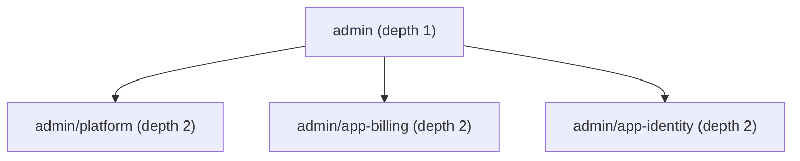

# Codification: Namespaces

## 1. Purpose

Transform the raw namespace inventory captured by `discovery-namespaces` into
idiomatic Terraform HCL. The skill emits one `vault_namespace` resource per
discovered namespace, wires children to parents with resource references (never
string paths), emits one `import {}` block per resource, and renders a Mermaid
hierarchy diagram plus a reference table for reviewers.

Input: `discovered_terraform/raw/namespaces.json`
Output: `discovered_terraform/terraform/admin/` (the `admin` namespace) and
`discovered_terraform/terraform/namespaces/` (tenant namespaces), plus
`namespaces/hierarchy.md`.

## 2. Governance

All eleven shared coding standards apply (see section 7). Additional rules
specific to this skill:

- **Root namespace is never emitted.** The root namespace (`""` / `root`) has no
  `vault_namespace` resource. Skip it even if present in `namespaces.json`.
- **Children reference their parent by resource reference**, e.g.
  `namespace = vault_namespace.admin.path_fq`. A literal parent path string such
  as `"admin"` or `"admin/"` in a `vault_namespace` block is a defect.
- **Ownership**: `vault_namespace` is owned by this skill only. Do not emit
  policies, mounts, auth backends or identity objects.
- **Layer placement**: `admin` goes to `admin/`; every other namespace goes to
  `namespaces/`. A child in `namespaces/` of a parent in `admin/` is a
  cross-layer reference: resolve it through the `admin` layer output
  `namespace_paths` (consumed with `data "terraform_remote_state"`), keeping the
  same expression shape in the generated block.

## 3. Prerequisites

1. `discovered_terraform/raw/namespaces.json` exists and parses as JSON. If it
   is missing, stop and ask the user to run `discovery-namespaces` (TASK-007).
2. The naming library (TASK-003) is available and exposes `label(namespace,
   path, name)`.
3. The provider template (TASK-002) is available (`versions.tf`, `providers.tf`).
4. `/opt/homebrew/bin/terraform` is present for the validation step.

## 4. Process

1. **Load** `discovered_terraform/raw/namespaces.json`. Each record carries
   `path` (full path), `id`, `custom_metadata`.
2. **Compute depth** as the number of `/`-separated segments in the full path
   (`admin` = 1, `admin/platform` = 2). Drop the root namespace.
3. **Detect cycles / orphans.** Build the parent map (`parent = dirname(path)`).
   Every parent other than the root must itself be in the set. A missing parent
   or a cycle triggers a stop condition (section 9).
4. **Sort by depth ascending**, then alphabetically, so parents are always
   emitted before children.
5. **Generate one `vault_namespace` block per namespace:**
   - Depth 1: `path = "<segment>"`, no `namespace` argument.
   - Depth >= 2: `path = "<last segment>"` and
     `namespace = vault_namespace.<parent_label>.path_fq`. `path_fq` is used
     instead of `path` so that depth 3+ resolves to the full parent path.
   - Emit `custom_metadata = { ... }` **only** when the map is non-empty.
   - Label = naming library output for the full path (`admin/app-billing` ->
     `admin_app_billing`).
6. **Generate `import {}` blocks** in `imports.tf` of the same layer:
   `to = vault_namespace.<label>`, `id = "<full path>"`. Use the import ID format
   confirmed by TASK-006 if it differs.
7. **Generate `namespaces/hierarchy.md`** with a Mermaid `graph TD` tree and a
   table with columns: full path, parent, id, custom_metadata, depth.
8. **Add the provenance header** to every `.tf` file and run
   `terraform fmt -check -recursive` and `terraform validate`.

## 5. Example HCL output (harness)

`discovered_terraform/terraform/admin/namespaces.tf`

```hcl
# Generated by vault-brownfield-codifier
# Capability: namespaces
# Doc ref: https://developer.hashicorp.com/vault/docs

resource "vault_namespace" "admin" {
  path = "admin"
}
```

`discovered_terraform/terraform/namespaces/namespaces.tf`

```hcl
# Generated by vault-brownfield-codifier
# Capability: namespaces
# Doc ref: https://developer.hashicorp.com/vault/docs

resource "vault_namespace" "admin_app_billing" {
  namespace = local.admin_namespace_path_fq
  path      = "app-billing"

  custom_metadata = {
    description = "Billing application team namespace"
  }
}

resource "vault_namespace" "admin_app_identity" {
  namespace = local.admin_namespace_path_fq
  path      = "app-identity"

  custom_metadata = {
    description = "Identity service team namespace"
  }
}

resource "vault_namespace" "admin_platform" {
  namespace = local.admin_namespace_path_fq
  path      = "platform"

  custom_metadata = {
    description = "Platform engineering team namespace"
  }
}
```

Where `local.admin_namespace_path_fq` is defined once in
`namespaces/main.tf` from `data.terraform_remote_state.admin.outputs.namespace_paths["admin"]`.
When parent and child share a layer, the expression is the direct reference
`vault_namespace.<parent_label>.path_fq`.

`discovered_terraform/terraform/admin/imports.tf` (namespaces portion)

```hcl
import {
  to = vault_namespace.admin
  id = "admin"
}
```

`discovered_terraform/terraform/namespaces/imports.tf`

```hcl
import {
  to = vault_namespace.admin_app_billing
  id = "admin/app-billing"
}

import {
  to = vault_namespace.admin_app_identity
  id = "admin/app-identity"
}

import {
  to = vault_namespace.admin_platform
  id = "admin/platform"
}
```

## 6. Example `namespaces/hierarchy.md` (harness)

````markdown
# Namespace hierarchy



| Full path | Parent | Id | custom_metadata | Depth |
|---|---|---|---|---|
| `admin` | root | `<id from namespaces.json>` | none | 1 |
| `admin/app-billing` | `admin` | `<id>` | description = Billing application team namespace | 2 |
| `admin/app-identity` | `admin` | `<id>` | description = Identity service team namespace | 2 |
| `admin/platform` | `admin` | `<id>` | description = Platform engineering team namespace | 2 |
````

The `Id` column is copied verbatim from `namespaces.json`; ids appear only in
`hierarchy.md` and never in `.tf` files other than `imports.tf`.

## 7. Coding standards applied

| # | Standard | How it applies here |
|---|---|---|
| 1 | Provenance header | Every `.tf` file starts with the 4-line header, `Capability: namespaces` |
| 2 | Provider pin | `hashicorp/vault ~> 4`, `required_version >= "1.9"`, `skip_child_token = true` from TASK-002 |
| 3 | Naming | `admin/app-billing` -> `admin_app_billing`; `r_` prefix for digit-leading labels |
| 4 | Namespace targeting | One style per run (default from TASK-006); examples use resource-level `namespace`; under alias style use `provider = vault.<parent_alias>` instead. Never mixed |
| 5 | Secret guard | No secret-bearing fields exist on `vault_namespace` |
| 6 | Ownership | Only `vault_namespace` is emitted |
| 7 | Import blocks | One per resource in the layer's `imports.tf` |
| 8 | Zero-TTL omission | Not applicable |
| 9 | Cross-references | Child -> parent via `.path_fq` reference |
| 10 | Empty set | If only the root namespace exists, emit no files and report "no namespaces" |
| 11 | Validation | `terraform fmt -check -recursive` and `terraform validate` must pass |

## 8. Acceptance criteria

- 4 `vault_namespace` resources for the harness: `admin`, `admin_platform`,
  `admin_app_billing`, `admin_app_identity`.
- The three tenants carry `custom_metadata.description` with the expected text;
  `admin` carries no `custom_metadata`.
- Every child references its parent by resource reference; this returns 0 lines:
  `grep -rnE 'namespace\s*=\s*"' discovered_terraform/terraform/*/namespaces.tf`
- No `"admin/"` string literal appears inside any `vault_namespace` block
  (import `id` values in `imports.tf` are exempt).
- 4 matching `import {}` blocks; `hierarchy.md` shows `admin` as parent of three
  tenants with depth 1 and 2.
- A scratch namespace `admin/platform/sre-team` is emitted at depth 3 with
  `namespace = vault_namespace.admin_platform.path_fq`.
- `terraform fmt -check -recursive` and `terraform validate` exit 0.

## 9. Stop conditions

- **Cycle detected** in the parent map: stop, print the cycle members, write
  nothing.
- **Orphan detected** (parent not in the set and not root): stop and report the
  missing parent; do not fabricate a `vault_namespace` for it.
- `namespaces.json` missing or invalid JSON.
- Two namespaces normalise to the same Terraform label: stop and report both
  paths (CAC6, label uniqueness).
