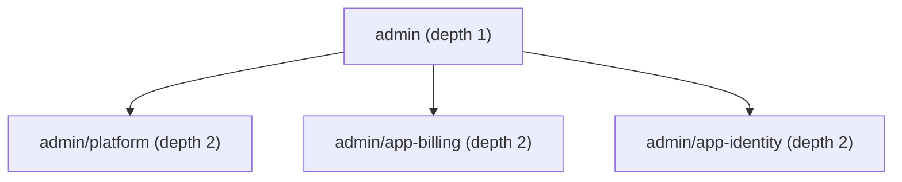

## 6. Example `namespaces/hierarchy.md` (harness)

````markdown
# Namespace hierarchy



| Full path | Parent | Id | custom_metadata | Depth |
|---|---|---|---|---|
| `admin` | root | `<id from namespaces.json>` | none | 1 |
| `admin/app-billing` | `admin` | `<id>` | description = Billing application team namespace | 2 |
| `admin/app-identity` | `admin` | `<id>` | description = Identity service team namespace | 2 |
| `admin/platform` | `admin` | `<id>` | description = Platform engineering team namespace | 2 |
````

The `Id` column is copied verbatim from `namespaces.json`; ids appear only in
`hierarchy.md` and never in `.tf` files other than `imports.tf`.
