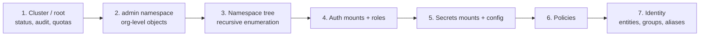

# Brownfield Discovery Guide — Capturing a Live Vault Enterprise Cluster as Terraform

> Audience: practitioners running the codifier (or doing it by hand) against an existing Vault Enterprise cluster.
> Harness used for the examples: Vault Enterprise 2.2.2+ent at `http://127.0.0.1:8200`; namespaces `root`, `admin`, `admin/platform`, `admin/app-billing`, `admin/app-identity`; AppRole auth and KV v2 `secret/` in each tenant namespace.
> Rule of the whole guide: **discovery is strictly read-only.** No command below writes to Vault.

---

## 1. Prerequisites

### 1.1 Tooling

| Tool | Minimum | Why |
|---|---|---|
| `vault` CLI | ≥ 1.17 (harness Makefile requirement) | Discovery commands, `-namespace` flag, `-format=json` |
| `terraform` | ≥ 1.9 (harness `required_version`) | `import` blocks, `-generate-config-out`, provider aliases |
| `jq` | any recent | Parsing `-format=json` output, namespace traversal |
| `hashicorp/vault` provider | `~> 4` (4.8.0 in harness) | Target of codification |

```bash
export VAULT_ADDR=http://127.0.0.1:8200
# Harness only: dev root token. In real brownfield use a short-lived token from the discovery AppRole (section 1.3).
export VAULT_TOKEN=root
# Avoid a stray ~/.vault config interfering (the harness Makefile does this)
export VAULT_CONFIG_PATH=/dev/null
vault status -format=json | jq '{initialized, sealed, version, type}'
```

### 1.2 Suggested read-only discovery policy

Apply this policy **in each namespace you will inspect** (and in root). It is deliberately *not* `path "*"` with `sudo`; it grants read/list only. Policy names are namespace-scoped, so it must exist in every namespace where the discovery token is used, or the token must be minted in `root`/`admin` and carry a policy in each namespace via a group (see Pitfalls).

```hcl
# codifier-discovery.hcl — READ-ONLY survey of Vault configuration.
# Intentionally has no access to secret data (KV data paths) or credentials.

# Namespaces
path "sys/namespaces"            { capabilities = ["list"] }
path "sys/namespaces/*"          { capabilities = ["read", "list"] }

# Auth + secrets mounts and their tuning
path "sys/auth"                  { capabilities = ["read"] }
path "sys/auth/*"                { capabilities = ["read"] }
path "sys/mounts"                { capabilities = ["read"] }
path "sys/mounts/*"              { capabilities = ["read"] }

# Policies (ACL, plus Enterprise Sentinel)
path "sys/policies/acl"          { capabilities = ["list"] }
path "sys/policies/acl/*"        { capabilities = ["read"] }
path "sys/policies/egp"          { capabilities = ["list"] }
path "sys/policies/egp/*"        { capabilities = ["read"] }
path "sys/policies/rgp"          { capabilities = ["list"] }
path "sys/policies/rgp/*"        { capabilities = ["read"] }
path "sys/policy"                { capabilities = ["list"] }
path "sys/policy/*"              { capabilities = ["read"] }

# Cluster-level (root namespace only)
path "sys/audit"                 { capabilities = ["read"] }
path "sys/quotas/config"         { capabilities = ["read"] }
path "sys/quotas/rate-limit"     { capabilities = ["list"] }
path "sys/quotas/rate-limit/*"   { capabilities = ["read"] }
path "sys/quotas/lease-count"    { capabilities = ["list"] }
path "sys/quotas/lease-count/*"  { capabilities = ["read"] }
path "sys/health"                { capabilities = ["read"] }
path "sys/seal-status"           { capabilities = ["read"] }

# Identity
path "identity/entity/id"          { capabilities = ["list"] }
path "identity/entity/id/*"        { capabilities = ["read"] }
path "identity/entity/name"        { capabilities = ["list"] }
path "identity/entity/name/*"      { capabilities = ["read"] }
path "identity/entity-alias/id"    { capabilities = ["list"] }
path "identity/entity-alias/id/*"  { capabilities = ["read"] }
path "identity/group/id"           { capabilities = ["list"] }
path "identity/group/id/*"         { capabilities = ["read"] }
path "identity/group/name"         { capabilities = ["list"] }
path "identity/group/name/*"       { capabilities = ["read"] }
path "identity/group-alias/id"     { capabilities = ["list"] }
path "identity/group-alias/id/*"   { capabilities = ["read"] }

# Auth method configuration and roles (config only; never secret-id or login paths)
path "auth/+/config"             { capabilities = ["read"] }
path "auth/+/role"               { capabilities = ["list"] }
path "auth/+/role/+"             { capabilities = ["read"] }
path "auth/+/roles"              { capabilities = ["list"] }
path "auth/+/roles/*"            { capabilities = ["read"] }
path "auth/+/groups"             { capabilities = ["list"] }
path "auth/+/groups/*"           { capabilities = ["read"] }
path "auth/+/users"              { capabilities = ["list"] }
path "auth/+/users/*"            { capabilities = ["read"] }

# Secrets-engine configuration (KV config, PKI roles/config). NOT KV data.
path "+/config"                  { capabilities = ["read"] }
path "+/config/*"                { capabilities = ["read"] }
path "+/roles"                   { capabilities = ["list"] }
path "+/roles/*"                 { capabilities = ["read"] }
path "+/metadata"                { capabilities = ["list"] }  # existence of secret paths only

# Explicitly deny secret payloads
path "+/data/*"                  { capabilities = ["deny"] }
```

Notes on this policy:

- `+/config` is a convenience wildcard and will also match `auth/config`-like paths on custom mounts; it still only grants `read`. Tighten to specific mount names in production.
- Some config endpoints return sensitive values (e.g. `database/config/*` may reveal connection URLs, never passwords). If your auditors object, drop the wildcard and enumerate mounts.
- `deny` on `+/data/*` is evaluated with highest precedence; KV v2 secret payloads cannot be read by the discovery token.
- Upstream harness does **not** include a discovery policy; the harness' `operator` policy is `path "*"` with `sudo` (`test/terraform/admin/policies/operator.hcl`). Do not use the operator policy for discovery outside a dev box.

### 1.3 Obtaining a discovery token (AppRole, per HVD "auth method per workload")

```bash
vault policy write codifier-discovery codifier-discovery.hcl            # root
vault write auth/approle/role/codifier-discovery \
  token_policies=codifier-discovery token_ttl=30m token_max_ttl=1h \
  secret_id_num_uses=1 secret_id_ttl=15m
ROLE_ID=$(vault read -field=role_id auth/approle/role/codifier-discovery/role-id)
SECRET_ID=$(vault write -f -field=secret_id auth/approle/role/codifier-discovery/secret-id)
export VAULT_TOKEN=$(vault write -field=token auth/approle/login role_id="$ROLE_ID" secret_id="$SECRET_ID")
```

Mirror the harness' AppRole settings (`secret_id_num_uses = 1`, `secret_id_ttl` ≤ 30 min) — the discovery credential should be single-use and short-lived.

---

## 2. Discovery order — and why



| # | Step | Why it must come here |
|---|---|---|
| 1 | **Root** (`status`, audit, quotas, root auth/mounts/policies) | Root-only objects (audit devices, global quotas, replication) cannot be read or imported from child namespaces. Also confirms edition, version, seal state and that your token works before any further work. |
| 2 | **`admin`** namespace objects | HVD makes `admin` the parent of all tenants and the home of human-access auth methods, tenant-admin groups and the provisioning policies. Everything below depends on it. |
| 3 | **Namespace tree** | You cannot discover tenant content without knowing every namespace path. Resolve the full tree first, then iterate per-namespace in steps 4–7. Terraform needs this to declare `vault_namespace` resources and provider aliases. |
| 4 | **Auth mounts and roles** | Auth mounts own the `mount_accessor` values that identity aliases refer to. Capture accessors → logical names *before* identity. |
| 5 | **Secrets mounts** (+ tune, KV config) | Policies reference mount paths (`secret/data/...`); knowing which mounts exist lets you validate policy paths. |
| 6 | **Policies** | Roles, groups and entities reference policies by name; collect the full set so references can be resolved/validated. |
| 7 | **Identity** | Depends on everything: groups reference policies, aliases reference auth-mount accessors, entities reference both. Must be last. |

Terraform apply/import order is the **same order** (root → admin → tenant) and is the reverse of destroy order.

---

## 3. Per-capability discovery commands

Pattern: set `VAULT_NAMESPACE` per call (or use `-namespace=`). Unset it for root. `vault ... -format=json | jq` keeps results machine-readable. Create a working directory so output can be diffed later:

```bash
OUT=./discovery; mkdir -p "$OUT"
```

### 3.1 Cluster and root namespace (step 1)

```bash
unset VAULT_NAMESPACE
vault status -format=json                          > "$OUT/root/status.json"
vault audit list -detailed -format=json            > "$OUT/root/audit.json"
vault read -format=json sys/quotas/config          > "$OUT/root/quota-config.json"
vault list -format=json sys/quotas/rate-limit      > "$OUT/root/quota-rate-limit.list.json"
vault list -format=json sys/quotas/lease-count     > "$OUT/root/quota-lease-count.list.json" 2>/dev/null || true
# each rate-limit quota
for q in $(vault list -format=json sys/quotas/rate-limit | jq -r '.[]'); do
  vault read -format=json "sys/quotas/rate-limit/$q" > "$OUT/root/quota-rate-limit.$q.json"
done
```

Harness expectation: one audit device (`file/`, `file_path=/vault/logs/audit.log`) and one rate-limit quota `global-rate-limit` (`path=""`, `rate=1000`, `interval=60`, `block_interval=60`).

### 3.2 Namespaces (step 3 — see also section 5 for recursion)

```bash
unset VAULT_NAMESPACE
vault namespace list -format=json                  # → ["admin/"]
VAULT_NAMESPACE=admin vault namespace list -format=json   # → ["app-billing/","app-identity/","platform/"]
vault namespace lookup -format=json admin          # id, path, custom_metadata
VAULT_NAMESPACE=admin vault namespace lookup -format=json platform
```

### 3.3 Auth methods and roles (step 4)

```bash
NS=admin/app-billing
VAULT_NAMESPACE=$NS vault auth list -detailed -format=json
#   keys are mount paths ("approle/"); fields: type, accessor, description, config{default_lease_ttl,max_lease_ttl,...}, options, local, seal_wrap

# Per-mount contents — AppRole
VAULT_NAMESPACE=$NS vault list -format=json auth/approle/role
VAULT_NAMESPACE=$NS vault read -format=json auth/approle/role/billing-service
VAULT_NAMESPACE=$NS vault read -format=json auth/approle/role/billing-service/role-id   # role_id is stable; fine to capture as an output, not required

# Per-mount contents — LDAP
VAULT_NAMESPACE=$NS vault read -format=json auth/ldap/config            # bindpass is NOT returned
VAULT_NAMESPACE=$NS vault list -format=json auth/ldap/groups
VAULT_NAMESPACE=$NS vault read -format=json auth/ldap/groups/<group>
VAULT_NAMESPACE=$NS vault list -format=json auth/ldap/users

# Per-mount contents — OIDC / JWT
VAULT_NAMESPACE=$NS vault read -format=json auth/oidc/config            # oidc_client_secret is NOT returned
VAULT_NAMESPACE=$NS vault list -format=json auth/oidc/role
VAULT_NAMESPACE=$NS vault read -format=json auth/oidc/role/<role>

# Token roles
VAULT_NAMESPACE=$NS vault list -format=json auth/token/roles
```

**Never run:** `vault write auth/approle/role/<r>/secret-id`, `.../secret-id/lookup`, `.../secret-id-accessor/*`, `auth/*/login`. They are credential operations, not configuration.

### 3.4 Secrets engines (step 5)

```bash
VAULT_NAMESPACE=$NS vault secrets list -detailed -format=json
#   fields: type, accessor, description, options (e.g. {"version":"2"}), config{default_lease_ttl,max_lease_ttl,...}, seal_wrap, local

VAULT_NAMESPACE=$NS vault read -format=json sys/mounts/secret/tune        # authoritative tune values
VAULT_NAMESPACE=$NS vault read -format=json sys/auth/approle/tune         # auth mount tune

# KV v2 engine config
VAULT_NAMESPACE=$NS vault read -format=json secret/config

# KV v2 — structure only (path inventory, NOT values)
VAULT_NAMESPACE=$NS vault kv list -format=json -mount=secret /            # top-level folders
VAULT_NAMESPACE=$NS vault kv list -format=json -mount=secret billing-service

# PKI (if present)
VAULT_NAMESPACE=$NS vault list -format=json pki/roles
VAULT_NAMESPACE=$NS vault read -format=json pki/roles/<role>
VAULT_NAMESPACE=$NS vault read -format=json pki/config/urls
VAULT_NAMESPACE=$NS vault read -format=json pki/config/crl
VAULT_NAMESPACE=$NS vault list -format=json pki/issuers
```

Do **not** run `vault kv get` in discovery. The harness' smoke test does so only to verify `SYNTHETIC` markers.

### 3.5 Policies (step 6)

```bash
VAULT_NAMESPACE=$NS vault policy list -format=json                         # includes built-ins "default" (and "root" in root ns)
VAULT_NAMESPACE=$NS vault read -format=json sys/policies/acl/billing-developers-read
# or the raw HCL body, preferred for `file()` emission:
VAULT_NAMESPACE=$NS vault policy read billing-developers-read > "$OUT/$NS/policies/billing-developers-read.hcl"
# Sentinel (Enterprise)
VAULT_NAMESPACE=$NS vault list -format=json sys/policies/egp
VAULT_NAMESPACE=$NS vault list -format=json sys/policies/rgp
```

### 3.6 Identity (step 7)

```bash
VAULT_NAMESPACE=admin vault list -format=json identity/entity/name
VAULT_NAMESPACE=admin vault read -format=json identity/entity/name/synthetic-user-platform-sre
VAULT_NAMESPACE=admin vault list -format=json identity/entity-alias/id
VAULT_NAMESPACE=admin vault list -format=json identity/group/name
VAULT_NAMESPACE=admin vault read -format=json identity/group/name/vault-platform-admin
VAULT_NAMESPACE=admin vault list -format=json identity/group-alias/id
VAULT_NAMESPACE=admin vault read -format=json identity/group-alias/id/<id>
```

Harness expectation in `admin`: 3 tenant-admin groups (`vault-platform-admin`, `vault-app-billing-admin`, `vault-app-identity-admin`), 6 team groups (`vault-<tenant>-<team>`), 6 entities (`synthetic-user-<tenant>-<team>`), and **0 aliases** (the harness creates none — this is a coverage gap for group-alias/entity-alias codification).

Resolve accessors to mount names with:

```bash
VAULT_NAMESPACE=admin vault auth list -detailed -format=json | jq 'to_entries|map({path:.key,accessor:.value.accessor})'
```

### 3.7 One-shot snapshot of everything in a namespace

```bash
snapshot_ns() {
  local ns="$1" d="$OUT/${1:-root}"; mkdir -p "$d"
  export VAULT_NAMESPACE="$ns"
  vault auth list    -detailed -format=json > "$d/auth.json"
  vault secrets list -detailed -format=json > "$d/mounts.json"
  vault policy list  -format=json           > "$d/policies.json"
  vault list -format=json identity/group/name  > "$d/groups.json"  2>/dev/null || echo '[]' > "$d/groups.json"
  vault list -format=json identity/entity/name > "$d/entities.json" 2>/dev/null || echo '[]' > "$d/entities.json"
  vault namespace list -format=json         > "$d/namespaces.json" 2>/dev/null || echo '[]' > "$d/namespaces.json"
  unset VAULT_NAMESPACE
}
```

Note `vault list` exits non-zero (code 2) with "No value found" on an empty list; the `|| echo '[]'` fallback handles that.

---

## 4. What to capture vs what to skip

| Category | Capture | Skip | Reason |
|---|---|---|---|
| **Namespaces** | All user-created (`admin`, tenants, nested) | — | Foundation of provider aliasing |
| **Auth mounts** | All user-enabled mounts and their tune | `token/` (built-in, cannot be disabled; only token *roles* are codified) | `token/` is created by Vault |
| **Auth roles** | AppRole roles, OIDC/JWT roles, LDAP groups, token roles | SecretIDs, SecretID accessors, login results | Ephemeral, credential-bearing |
| **Auth config with secrets** | Everything *except* write-only fields | `bindpass`, `oidc_client_secret`, `jwt_validation_pubkeys` (if secret), private keys | Not returned by the API; supply via variables |
| **Secrets mounts** | User-enabled engines (e.g. `secret/` KV v2) | `sys/`, `identity/`, `cubbyhole/` (internal, system-generated, always present) | Cannot/should not be managed as resources |
| **Secret data** | Path inventory only (to build policies/tests); optionally KV v2 **custom metadata** | KV values, dynamic credentials, generated PKI keys, issued certs | Would put secrets in state and VCS |
| **Policies** | All ACL policies | `root` (built-in, cannot be modified/deleted); `default` unless you have deliberately changed it | Built-ins |
| **Identity** | Hand-authored entities/groups (name pattern, metadata); external groups and their aliases | Entities and aliases **auto-created on first login** (e.g. names equal to usernames or role-ids, metadata `role_name`/`role_id`); anonymous AppRole entities | They regenerate on next login; codifying them creates permanent drift |
| **Audit** | Audit devices | — | Root-only |
| **Quotas** | Rate-limit, lease-count | — | Root-managed; may target namespaces |
| **Tokens** | **Nothing** | All tokens and accessors | Ephemeral |
| **Leases** | **Nothing** | All leases (`sys/leases/*`) | Ephemeral |
| **Root-generated** | — | Root token, unseal/recovery keys, initial `root` policy, generated root CA private keys | Created at init, never in config |
| **Server config** | Document only | Listener, storage, seal, `license_path` (`test/vault/config.hcl`) | Not manageable via the Vault API/provider |

Heuristic for entities: if the entity's `metadata` contains harness-style markers (e.g. `type = "synthetic"`) or an operator-defined naming convention, it is authored → capture. If its only alias is an AppRole role-id/OIDC `sub` and it has no policies or group memberships you recognise, it is auto-created → skip.

---

## 5. Namespace traversal (recursive listing)

`vault namespace list` returns **direct children only**, with a trailing `/`, relative to `VAULT_NAMESPACE`. Walk the tree depth-first:

```bash
walk_namespaces() {   # usage: walk_namespaces "" → prints full paths (no trailing slash)
  local parent="$1" child full
  while IFS= read -r child; do
    [ -z "$child" ] && continue
    child="${child%/}"
    full="${parent:+$parent/}$child"
    echo "$full"
    walk_namespaces "$full"
  done < <(VAULT_NAMESPACE="$parent" vault namespace list -format=json 2>/dev/null | jq -r '.[]?' )
}

walk_namespaces ""
# admin
# admin/app-billing
# admin/app-identity
# admin/platform
```

Guidance:

- `vault namespace list` on a namespace with no children exits non-zero (`No namespaces found`) — hence `2>/dev/null` and `.[]?`.
- Include the root namespace (`""`) explicitly as the first item for per-namespace snapshotting: `for ns in "" $(walk_namespaces ""); do snapshot_ns "$ns"; done`.
- Generate **one Terraform provider alias per path** and sort by depth so parents are created before children.
- Cross-check with the API: `curl -s -H "X-Vault-Token: $VAULT_TOKEN" -X LIST "$VAULT_ADDR/v1/sys/namespaces"` (add `-H "X-Vault-Namespace: admin"` for children).
- Enterprise limits: namespace nesting depth and total number are limited; check `vault read sys/license/status` / docs for your version before generating very deep trees. (verify)

---

## 6. Pitfalls

| # | Pitfall | Symptom | Mitigation |
|---|---|---|---|
| 1 | **Import conflicts / "resource already exists"** | `terraform apply` of a freshly authored resource fails with "path is already in use at approle/" | Always `import` before first apply. Run `terraform plan` and require **no create actions** for objects that already exist. |
| 2 | **Wrong provider alias / namespace on import** | `import` succeeds but plan shows replace, or "no value found" | The import runs in the namespace of the provider (or `TERRAFORM_VAULT_NAMESPACE_IMPORT` env var for resources with a `namespace` argument — verify for your provider version). Prefer `import {}` blocks with an explicit `provider = vault.<alias>`. |
| 3 | **One token, many aliases** | `permission denied` creating child token | Set `skip_child_token = true` (the harness does) or grant `auth/token/create` in every namespace. |
| 4 | **Provider alias for a not-yet-existing namespace** | `plan` fails: namespace not found | Namespaces must exist **before** a provider that targets them is used. Split into state layers (root → admin → tenants), as the harness does with three directories. Never put `vault_namespace` and resources inside it in the same root module state unless using targeted applies. |
| 5 | **Root-only resources attempted in a namespace** | `permission denied`/404 on `sys/audit` or global quota | Audit devices, replication, global quotas, license: root tier only. |
| 6 | **Sensitive values leaking** | Secrets appear in `terraform.tfstate`, plan output, or generated HCL | Mark variables `sensitive`, never emit values from `vault read` into HCL; use `SYNTHETIC-*` fixtures (harness convention); encrypt remote state; do not commit `.tfstate` (note: harness has `terraform.tfstate` files on disk — they are covered by `test/.gitignore` and must stay out of VCS). |
| 7 | **Write-only fields cause permanent diff** | `bindpass`, `oidc_client_secret` always show as changed or always unchanged | Provide value from a sensitive variable; or `lifecycle { ignore_changes = [...] }` after documenting why. |
| 8 | **Auto-created identities codified** | Entities/aliases reappear after destroy; drift each login | Skip per section 4. |
| 9 | **Group membership managed in two places** | Plan flaps between inline `member_entity_ids` and `vault_identity_group_member_entity_ids` | Choose one mechanism per group; set `external_member_entity_ids = true` if using the separate resource. |
| 10 | **Policy references to non-existent names** | Role or group created, tokens fail at login with missing policy | Validate every `token_policies`/`policies` entry against the captured policy list in the same namespace. Remember `default` is implicitly attached. |
| 11 | **Policy HCL escaping** | `${…}` inside policy templates is interpreted by Terraform | Use `file()` for `.hcl`, or `$${identity.entity.name}` in heredocs. |
| 12 | **Accessor hardcoding** | Wrong alias after rebuild | Always `vault_auth_backend.<x>.accessor`. |
| 13 | **Trailing slashes** | `approle/` vs `approle` mismatch → perpetual diff | Strip trailing `/` from mount paths in HCL; the API returns them with it. |
| 14 | **Replace-on-rename** | Renaming `vault_policy` or `vault_namespace` destroys the old object | Use `moved {}` blocks only for Terraform-address renames; Vault-side renames are destructive. For namespaces, destruction requires the namespace to be empty. |
| 15 | **Audit device lock-out** | Cluster refuses requests after audit device enabled on a bad path | Verify `file_path` is writable, keep ≥ 2 devices in production. Note the harness only has one file device. |
| 16 | **Dev-mode artefacts** | In-memory storage lost on stop; root token `root` | Harness-only. `vault_token` must never be hardcoded; harness passes it via `-var` / `VAULT_TOKEN`. |
| 17 | **Provider/Vault version skew** | Missing fields (Vault 2.2.2+ent is newer than many provider docs) | Pin provider; run `terraform validate`; treat unknown API fields as gaps to report rather than silently dropping. |

---

## 7. Terraform import strategy

### 7.1 Principles

1. Prefer **`import {}` blocks** (Terraform ≥ 1.5) over CLI `terraform import`: they are reviewable and repeatable. Use `terraform plan -generate-config-out=generated.tf` only to bootstrap; then rewrite to HVD style (loops, `file()` policies, module boundaries).
2. Import **in tier order**: root → admin → tenant. One state per tier (harness: `test/terraform/{admin,namespaces,seed}`).
3. After every batch: `terraform plan` must show **0 to add, 0 to destroy**; the only acceptable changes are in-place updates you can explain.

```hcl
# Example: tenant-layer import block (provider alias per namespace)
import {
  provider = vault.app_billing
  to       = vault_auth_backend.billing_approle
  id       = "approle"
}
```

### 7.2 Import ID patterns (verify against provider docs for 4.8.0 before use)

| Resource | Import ID | CLI example |
|---|---|---|
| `vault_namespace` | namespace `path` (relative to the provider's namespace) | `terraform import vault_namespace.admin admin` |
| `vault_audit` | audit device path | `terraform import vault_audit.file file` |
| `vault_auth_backend` | mount path (no trailing `/`) | `terraform import vault_auth_backend.approle_root approle` |
| `vault_approle_auth_backend_role` | `auth/<mount>/role/<name>` | `terraform import vault_approle_auth_backend_role.billing_app auth/approle/role/billing-service` |
| `vault_ldap_auth_backend` | `auth/<mount>` or mount path (verify) | `terraform import vault_ldap_auth_backend.ldap ldap` |
| `vault_jwt_auth_backend` (OIDC) | `auth/<mount>` or mount path (verify) | `terraform import vault_jwt_auth_backend.oidc oidc` |
| `vault_policy` | policy name | `terraform import vault_policy.operator operator` |
| `vault_mount` | mount path | `terraform import vault_mount.billing_secret secret` |
| `vault_kv_secret_backend_v2` | mount path | `terraform import vault_kv_secret_backend_v2.cfg secret` |
| `vault_kv_secret_v2` | `<mount>/data/<name>` | `terraform import vault_kv_secret_v2.billing_checkout secret/data/billing-service/checkout` (**only for fixtures; do not import real secrets**) |
| `vault_pki_secret_backend_role` | `<mount>/roles/<name>` | `terraform import vault_pki_secret_backend_role.web pki/roles/web` |
| `vault_identity_entity` | entity **UUID** | `terraform import 'vault_identity_entity.team_member["platform-sre"]' <uuid>` |
| `vault_identity_group` | group **UUID** | `terraform import 'vault_identity_group.tenant_admin["platform"]' <uuid>` |
| `vault_identity_group_alias` | alias **UUID** | `terraform import vault_identity_group_alias.oidc_admins <uuid>` |
| `vault_identity_entity_alias` | alias **UUID** | `terraform import vault_identity_entity_alias.x <uuid>` |
| `vault_quota_rate_limit` | quota name | `terraform import vault_quota_rate_limit.global global-rate-limit` |

Getting the UUIDs:

```bash
VAULT_NAMESPACE=admin vault read -field=id identity/group/name/vault-platform-admin
VAULT_NAMESPACE=admin vault read -field=id identity/entity/name/synthetic-user-platform-sre
VAULT_NAMESPACE=admin vault list -format=json identity/group-alias/id
```

### 7.3 Translating `for_each` objects

The harness builds tenants with `for_each = var.tenants` and teams with a flattened local map (`${tenant}-${team}`). For brownfield, build the `for_each` key from a **stable human key** (tenant name, `tenant-team`), and emit import blocks like:

```hcl
import {
  provider = vault.admin
  for_each = var.tenants          # Terraform ≥ 1.7
  to       = vault_namespace.tenant[each.key]
  id       = each.key
}
```

(`import` with `for_each` needs Terraform ≥ 1.7; the harness requires ≥ 1.9, which satisfies this.)

---

## 8. Validation checklist

Perform after generating HCL and importing. All items should be green before declaring the codification complete.

### 8.1 Static
- [ ] `terraform fmt -check -recursive` passes in each layer (`make fmt`).
- [ ] `terraform init -backend=false && terraform validate` passes in each layer (`make validate`).
- [ ] No literal tokens, role IDs, secret IDs, bind passwords, client secrets or private keys in `*.tf`, `*.hcl`, `*.tfvars` (`grep -RniE 'hvs\.|s\.[A-Za-z0-9]{24}|BEGIN (RSA |EC )?PRIVATE' .`).
- [ ] Any KV fixture value starts with `SYNTHETIC-` or is obviously non-production.

### 8.2 Plan equality (the core test)
- [ ] `terraform plan -detailed-exitcode` returns **0** (no changes) for every tier, in order root → admin → each tenant.
- [ ] Any non-empty plan is explained (write-only fields) and documented with `ignore_changes` + comment.

### 8.3 Inventory equality (independent of Terraform)
Compare counts and names between live Vault and Terraform state:

```bash
# Example: policies in admin namespace vs state
live=$(VAULT_NAMESPACE=admin vault policy list -format=json | jq -r '.[]' | grep -vE '^(default|root)$' | sort)
tf=$(cd test/terraform/namespaces && terraform state list | grep '^vault_policy\.' >/dev/null && \
     terraform show -json | jq -r '.values.root_module.resources[]|select(.type=="vault_policy")|.values.name' | sort)
diff <(echo "$live") <(echo "$tf") && echo "policies match"
```

Repeat for: namespaces (`walk_namespaces`), auth mounts (`vault auth list -format=json | jq 'keys'`), secrets mounts (excluding `sys/ identity/ cubbyhole/`), AppRole roles, identity groups/entities, quotas, audit devices.

Expected harness numbers:

| Object | Expected count |
|---|---|
| Namespaces under root | 1 (`admin`) |
| Namespaces under `admin` | 3 (`platform`, `app-billing`, `app-identity`) |
| Auth mounts per namespace (excluding `token/`) | 1 (`approle/`) — in root, `admin` and each of the 3 tenants |
| User secrets mounts per tenant | 1 (`secret/`, KV v2) |
| Root policies (excluding `default`, `root`) | 1 (`operator`) |
| `admin` policies | 2 (`admin`, `namespace-admin`) |
| Tenant policies | 2 each (6 total) |
| `admin` identity groups | 9 (3 tenant admin + 6 team) |
| `admin` identity entities | 6 |
| Audit devices | 1 (`file/`) |
| Rate-limit quotas | 1 (`global-rate-limit`) |

### 8.4 Behavioural
- [ ] AppRole login works in each namespace with a fresh SecretID and returns only the expected policies.
- [ ] A token from `billing-service` can read `secret/data/billing-service/*` and **cannot** read `secret/data/identity-service/*` or anything in another namespace.
- [ ] `make smoke-test` (harness) passes.

### 8.5 Idempotency and drift
- [ ] Second `terraform apply` is a no-op.
- [ ] Introduce a manual change (e.g. edit a policy via CLI), run `terraform plan`, confirm drift is detected, then restore.

### 8.6 Hygiene
- [ ] State files are not committed and are stored in an encrypted remote backend for real clusters.
- [ ] Discovery token revoked: `vault token revoke -self`.
- [ ] Discovery output directory (`./discovery`) deleted or kept out of VCS if it contains anything sensitive.
