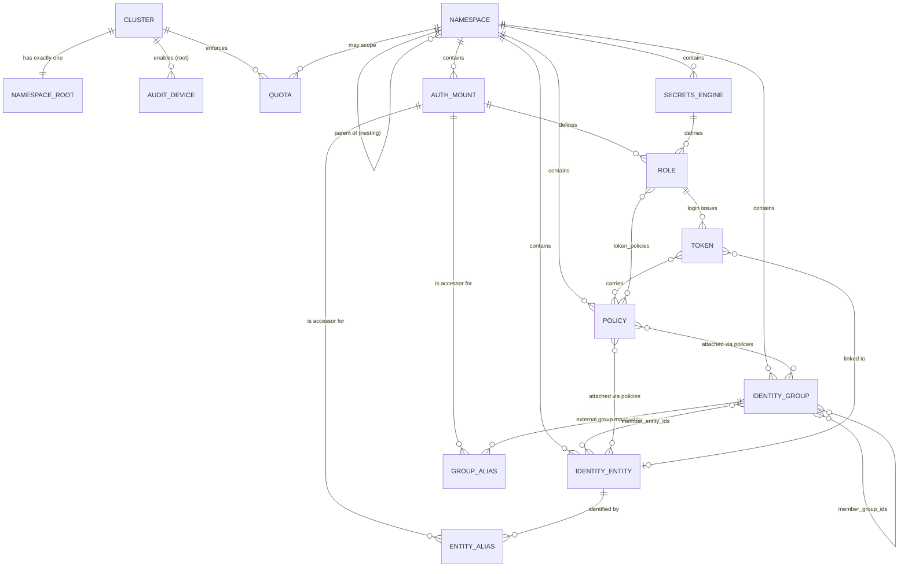
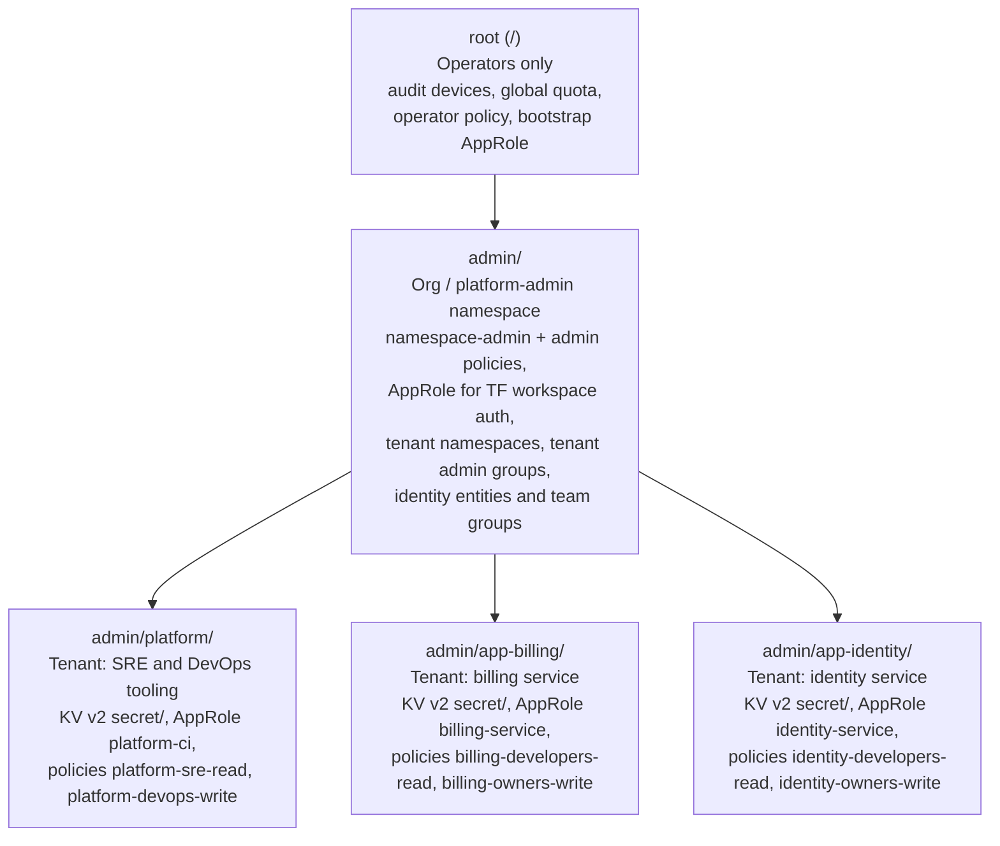

# Domain Model — Vault Configuration Surface for Terraform Codification

> Scope: the parts of HashiCorp Vault Enterprise configuration that the codifier must discover, model and emit as Terraform HCL (`hashicorp/vault` provider `~> 4`, 4.8.0 installed in the harness).
> Harness: Vault Enterprise 2.2.2+ent at `http://127.0.0.1:8200`; namespaces `root`, `admin`, `admin/platform`, `admin/app-billing`, `admin/app-identity`.
> HVD source: `git@github.com:hashicorp/web-unified-docs.git` → `content/validated-designs/docs/docs/vault/administration-guide/vault-organizational-concepts.mdx`.

---

## 1. Core entities

| Entity | Definition | Lives in | Codifiable? | Key attributes the codifier must capture |
|---|---|---|---|---|
| **Cluster** | The set of Vault nodes sharing one storage backend and one root namespace. Owns seal, replication, license, audit devices, global quotas. | n/a (cluster-wide) | Partly. Seal, listener, storage and license are **server config, not API-managed**; audit devices and quotas are API-managed. | Version, edition, replication mode, seal type, audit devices |
| **Namespace** | An isolated Vault "sub-instance" (Enterprise). Each has its own mounts, policies, identity store and tokens. Can nest. | Parent namespace | Yes | `path`, `custom_metadata`, parent, `id` |
| **AuthMount** | An enabled auth method at `auth/<path>/` (approle, ldap, oidc/jwt, userpass, …). | One namespace | Yes | `type`, `path`, `description`, tune settings, `accessor` |
| **SecretsEngine** | An enabled secrets engine at `<path>/` (kv, pki, transit, database, …). | One namespace | Yes (mount + config); **secret data is not codified** | `type`, `path`, `options` (e.g. `version=2`), tune settings |
| **Policy** | A named ACL policy document (HCL) granting capabilities on paths. Also EGP/RGP Sentinel policies (Enterprise). | One namespace | Yes | `name`, HCL body |
| **IdentityGroup** | A set of entities and/or child groups that share policies. `internal` (manually managed membership) or `external` (membership driven by a GroupAlias). | One namespace | Yes | `name`, `type`, `policies`, `member_entity_ids`, `member_group_ids`, `metadata` |
| **IdentityEntity** | A durable identity representing one person or machine across auth methods. | One namespace | Yes (but see "capture vs skip" in the discovery guide) | `name`, `policies`, `metadata`, `disabled`, `id` |
| **GroupAlias** | Links an `external` IdentityGroup to a group name in an auth mount (e.g. an OIDC `groups` claim value or LDAP group). | One namespace | Yes | `name`, `mount_accessor`, `canonical_id` (group id) |
| **EntityAlias** | Links an IdentityEntity to a login name on one AuthMount. | One namespace | Yes (usually auto-created at login; see skip rules) | `name`, `mount_accessor`, `canonical_id` (entity id) |
| **Token** | Runtime credential produced by a successful login (or `auth/token/create`). Carries policies, TTL, entity link. | One namespace | **No — ephemeral.** Only *token roles* and the *policies/TTLs on auth roles* are codified | accessor, policies, ttl |
| **Role** | Per-auth-method (or per-engine) definition of *who may log in / what may be issued* and which policies/TTLs apply. Examples: AppRole role, OIDC role, LDAP group mapping, PKI role, database role. | Inside an AuthMount or SecretsEngine | Yes | `role_name`, `token_policies`, `token_ttl`, `token_max_ttl`, `secret_id_*` (AppRole) |

Supporting entities (not in the requested list but required for a faithful model): **AuditDevice** (root), **Quota** (rate-limit / lease-count, root or namespace scoped), **MountTune** (TTL and listing settings on a mount), **Lease** (ephemeral, skipped).

---

## 2. Relationships (ER diagram)

Reading notes:

- A Namespace is the unit of isolation. **Everything in the diagram except Cluster-level objects is namespace-scoped**; the same `approle/` path in two namespaces is two independent mounts with different accessors.
- Policies attach to Roles/Groups/Entities **by name**, resolved in the namespace where the token is minted. A Policy in `admin` does not apply to a token minted in `admin/platform` unless the policy also exists there.
- `mount_accessor` is the join key between AuthMount ↔ Alias. Accessors are **generated** values; the codifier must emit a reference (`vault_auth_backend.x.accessor`), never a literal.

---

## 3. Namespace hierarchy

Observed in the harness (`test/terraform/*/main.tf`): the tenant namespaces are created by the `namespaces` layer through a provider aliased to `admin`, so their absolute paths are `admin/platform`, `admin/app-billing`, `admin/app-identity`. The ability to nest deeper (e.g. `admin/app-billing/prod`) exists in Vault and in the HVD, but is **not exercised** by the harness; the codifier's traversal must still be recursive.

---

## 4. Glossary — Vault terms ↔ Terraform

| Vault term | Meaning | Primary Terraform resource / data source | Gotcha |
|---|---|---|---|
| Root namespace | Top of the tree, cluster operator only | provider with no `namespace` argument | Some objects (audit, cluster-wide quotas, replication, `sys/config`) only work here |
| `admin` namespace | HVD org-level namespace under which tenants live | `vault_namespace` | Must be created from root before any aliased provider can target it |
| Namespace path | Relative to the parent used to create it | `vault_namespace.path` | `path_fq` is the computed fully qualified path; use it for provider `namespace` |
| Auth method / auth mount | Login mechanism at `auth/<path>` | `vault_auth_backend` (generic) + method-specific config resources | `type` and `path` are the identity of the resource |
| Secrets engine / mount | Backend at `<path>/` | `vault_mount` | KV v2 requires `options = { version = "2" }` |
| KV v2 engine config | `max_versions`, `cas_required`, `delete_version_after` | `vault_kv_secret_backend_v2` | Separate resource from the mount |
| Secret (KV data) | Stored value | `vault_kv_secret_v2` | **Writes secret material into Terraform state** — see SYNTHETIC-* convention |
| ACL policy | HCL path/capability document | `vault_policy` | Name is identity; `default` and `root` are built in |
| Sentinel policy (EGP/RGP) | Enterprise policy as code | `vault_egp_policy`, `vault_rgp_policy` | Not exercised in the harness |
| Role (AppRole) | Machine login definition | `vault_approle_auth_backend_role` | `role_id` is computed; SecretIDs are ephemeral and never codified |
| Entity | Durable identity | `vault_identity_entity` | Many entities are auto-created at first login; usually **do not** codify those |
| Entity alias | Entity ↔ (auth mount, login name) | `vault_identity_entity_alias` | Needs `mount_accessor`; one alias per entity per mount |
| Internal group | Manually-managed membership | `vault_identity_group` with `type = "internal"` | Membership via `member_entity_ids` here, or the separate `vault_identity_group_member_entity_ids` — pick one per group to avoid drift |
| External group | Membership from an IdP/LDAP | `vault_identity_group` with `type = "external"` + `vault_identity_group_alias` | Alias name must match IdP group string exactly |
| Group alias | External group ↔ (auth mount, IdP group name) | `vault_identity_group_alias` | Needs `mount_accessor` and `canonical_id` |
| Token | Runtime credential | *(none — not codified)* | Token **roles** (`auth/token/roles/*`) can be codified with `vault_token_auth_backend_role` |
| Lease | Time-bound grant for dynamic secrets | *(none)* | Lease limits are expressed as quotas and mount TTLs |
| Mount tune | TTLs, listing visibility, header passthrough | arguments on `vault_mount` / block `tune` on `vault_auth_backend` | Only the fields in the schema are expressible; see resource map |
| Audit device | Sink for audit log | `vault_audit` | Enabling a file device that cannot be written makes Vault **reject all requests**; keep at least one working device |
| Rate-limit quota | Request rate cap | `vault_quota_rate_limit` | `path = ""` is global; a namespace path scopes it |
| Lease-count quota | Max active leases | `vault_quota_lease_count` | Enterprise/1.x feature set; not in harness |
| Provider alias | Per-namespace provider config | `provider "vault" { alias = …, namespace = … }` | Required because one provider = one namespace context |

---

## 5. Layering in the HVD: root tier, platform tier, application tier

HVD (`vault-organizational-concepts.mdx`) states: reserve the root namespace for operators with root-level access because some configuration can only be made there; put tenant namespaces under `admin`; consolidate human access points centrally; and codify configuration with Terraform from a `vault-admin-config` repository, with application teams consuming common modules via their own consumer repositories.

Mapping to the harness' three Terraform layers:

```mermaid
flowchart LR
    subgraph T0["Tier 0 — Root tier (cluster operators)"]
      direction TB
      A1["vault_audit.file"]
      A2["vault_namespace.admin"]
      A3["vault_policy.operator"]
      A4["vault_auth_backend.approle_root<br/>+ role terraform-admin"]
      A5["vault_quota_rate_limit.global"]
    end
    subgraph T1["Tier 1 — Platform / admin tier (Vault admin team)"]
      direction TB
      B1["vault_policy admin, namespace-admin"]
      B2["approle (admin) +<br/>role namespace-provisioner"]
      B3["vault_namespace.tenant<br/>for_each tenants"]
      B4["vault_identity_group<br/>tenant admin + team groups"]
      B5["vault_identity_entity<br/>synthetic team members"]
    end
    subgraph T2["Tier 2 — Application / tenant tier (app teams)"]
      direction TB
      C1["vault_mount secret/ (KV v2)"]
      C2["vault_policy read / write<br/>per team"]
      C3["approle + role per app"]
      C4["vault_kv_secret_v2<br/>SYNTHETIC-* data"]
    end
    T0 --> T1 --> T2
```

| Tier | Namespace | Harness Terraform dir | Owner persona (HVD) | Contents |
|---|---|---|---|---|
| Root | `root` | `test/terraform/admin` | Vault operators | Audit, org namespace, operator policy, bootstrap AppRole, global rate limit |
| Platform / admin | `admin` | `test/terraform/namespaces` | Vault administrators (platform team) | Admin policies, provisioning AppRole, tenant namespaces, identity groups/entities |
| Application / tenant | `admin/<tenant>` | `test/terraform/seed` | Application owners (via consumer repos / modules) | KV v2 mount, team policies, app AppRole, secrets |

Codifier implication: the codified output should preserve this tiering as **separate Terraform root modules / state files** (one per tier, and per tenant in production). Dependencies flow strictly downward: tier N may only reference tier N-1 through variables, data sources or remote state, never the reverse.

> Note: the harness has no directory literally named `root`; root-tier resources live in `test/terraform/admin` (the "admin layer" applies to the **root** namespace and creates the `admin` namespace). Do not confuse the *directory* `admin` with the *namespace* `admin`.

---

## 6. Modelling rules derived for the codifier

1. **Identity of a resource = (namespace path, API path, name)**. All three are needed to generate a unique Terraform address and a correct provider alias.
2. **Emit one provider alias per namespace** and pass it via `provider = vault.<alias>` (or per-resource `namespace`), never rely on `VAULT_NAMESPACE` at plan time.
3. **Reference, don't hardcode, accessors and IDs** (`mount_accessor`, `canonical_id`, `backend`).
4. **Never codify ephemeral objects** (Tokens, Leases, SecretIDs, auto-created entities/aliases).
5. **Never codify secret values**; capture only the *existence and path structure* of KV data, and use `SYNTHETIC-*` placeholders where the harness needs fixture data.
6. **Respect scope limits**: Cluster-level and root-only objects are emitted only in the root tier.
